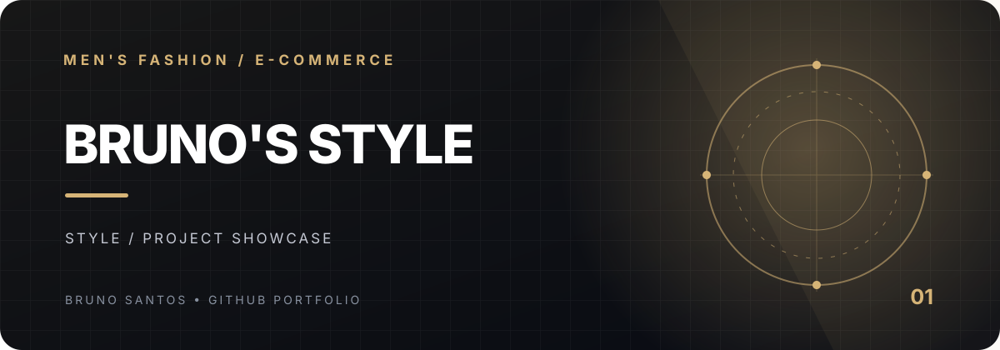

<div align="center">



# BRUNO'S STYLE
### MODA MASCULINA / DIGITAL EXPERIENCE

Protótipo front-end de loja de moda masculina, com catálogo por categorias, carrinho no navegador, seção demonstrativa de provador virtual e layout responsivo.

[](https://github.com/brunosg24/bruno-style-store)


</div>

---

## ✦ Visão do projeto

Protótipo front-end de loja de moda masculina, com catálogo por categorias, carrinho no navegador, seção demonstrativa de provador virtual e layout responsivo.

## ◈ Recursos / escopo

Catálogo, carrinho com persistência local, contato via WhatsApp e interface responsiva.

## ⌘ Tecnologias

HTML5 · CSS3 · JavaScript · localStorage

## ▶ Começar

```bash
git clone https://github.com/brunosg24/bruno-style-store.git
cd bruno-style-store
```

Abra `index.html` no navegador. A versão atual não exige instalação de dependências.

## 🧭 Próximos passos

- [ ] Evoluir a estrutura e os componentes do projeto.
- [ ] Melhorar experiência em dispositivos móveis.
- [ ] Documentar decisões técnicas e arquitetura.
- [ ] Adicionar testes e validações conforme as funcionalidades forem implementadas.

## ⚑ Status e transparência

Ainda não possui backend, autenticação real, banco de dados ou pagamento integrado.

<div align="center">

**BRUNO S.** · [GitHub](https://github.com/brunosg24)

</div>
